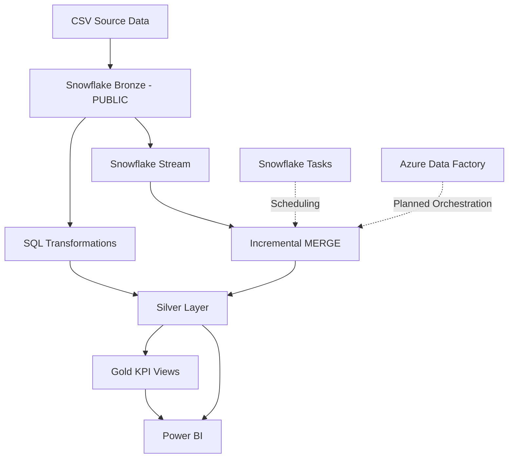

# ALIGN - E-Learning Data Engineering & Business Intelligence

## 1. Project Overview

This portfolio project is inspired by the ALIGN adaptive
learning initiative at Techinnov.

The objective is to build a modern data engineering and
business intelligence solution to analyze learner performance,
engagement, module effectiveness and learning progression.

The project implements an ELT pipeline using Snowflake,
SQL, Azure Data Factory and Power BI.

## 2. Business Objectives

- Monitor learner performance.
- Measure learning progression.
- Analyze module effectiveness.
- Identify learning difficulties.
- Track learner engagement.
- Support data-driven educational decisions.
- Automate incremental data processing.

## 3. Technologies

| Technology | Purpose |
|---|---|
| Snowflake | Cloud Data Warehouse |
| SQL | Data transformation and validation |
| Azure Data Factory | Pipeline orchestration |
| Snowflake Streams | Change Data Capture |
| Snowflake Tasks | Scheduled processing |
| MERGE | Incremental inserts and updates |
| Power BI | Data modeling and reporting |
| Power Query | Data preparation |
| DAX | Dynamic business KPIs |
| GitHub | Version control and documentation |

## 4. Data Architecture

## 5. Medallion Architecture

### Bronze Layer

- Raw data ingestion.
- Storage of source datasets.
- Preservation of source data.

### Silver Layer

- Data cleaning and transformation.
- Data type standardization.
- Duplicate validation.
- Missing value validation.
- Referential integrity checks.
- Incremental data processing.

### Gold Layer

- Business-ready aggregated datasets.
- Global learning performance KPIs.
- Module-level performance KPIs.

Gold views:

- V_KPI_GLOBAL
- V_KPI_MODULE

## 6. Data Model

The analytical model contains one fact table
and six dimension tables.

### Fact Table

- FACT_LEARNINGATTEMPT

### Dimension Tables

- DIM_USER
- DIM_MODULE
- DIM_DATE
- DIM_CONTENT_TYPE
- DIM_CONCEPT
- DIM_QUESTION

The Power BI model will use verified primary and
foreign keys to establish analytical relationships.

## 7. Incremental ELT and CDC

Snowflake Streams capture changes in incoming data.

The MERGE statement performs:

- INSERT for new learning attempts.
- UPDATE for existing learning attempts.

Snowflake Tasks provide scheduled processing.

Azure Data Factory is intended to provide external
pipeline orchestration and monitoring.

## 8. Data Quality

The following controls are implemented or planned:

- Primary key uniqueness.
- Duplicate detection.
- Null value detection.
- Foreign key validation.
- Score range validation.
- Data type validation.
- Source-to-target reconciliation.

## 9. Business KPIs

| KPI | Business Definition |
|---|---|
| Total Attempts | Number of learning attempts |
| Total Learners | Number of distinct learners |
| Total Modules | Number of learning modules |
| Average Initial Score | Mean score before learning |
| Average Final Score | Mean score after learning |
| Learning Improvement | Final score minus initial score |
| Pass Rate | Percentage of successful attempts |
| Average Learning Time | Mean time spent learning |
| Completion Rate | Percentage of completed attempts |

## 10. Validated Results

Current demonstration dataset:

| Indicator | Result |
|---|---:|
| Total Learning Attempts | 2,550 |
| Total Learners | 200 |
| Total Modules | 12 |
| Average Initial Score | 63.88 |
| Average Final Score | 72.80 |
| Average Improvement | 8.92 points |

Incremental loading tests validated the insertion
and update of learning attempts in Snowflake.

## 11. Power BI Reporting

Planned dashboard pages:

- Executive Overview
- Learner Performance
- Module Performance
- Learning Engagement
- Learning Progression

## 12. Project Status

- [x] Snowflake environment configuration
- [x] Bronze, Silver and Gold layers
- [x] SQL transformations
- [x] Data quality validation
- [x] Snowflake Streams
- [x] Incremental MERGE
- [x] Snowflake Tasks
- [x] Power BI connection to Snowflake
- [ ] Azure Data Factory orchestration validation
- [ ] Power BI semantic model
- [ ] Interactive dashboards
- [ ] Final deployment documentation

## 13. Data Privacy

This repository is a portfolio demonstration.
Only non-confidential demonstration data and
authorized code should be published.
No production credentials or proprietary data
are included.

## 14. Author

Mohamed Habib Ladjimi

BI Analyst | Data Engineering | Microsoft PL-300 Certified

Skills: Snowflake, SQL, Azure Data Factory,
Power BI, Python and Data Analytics.
