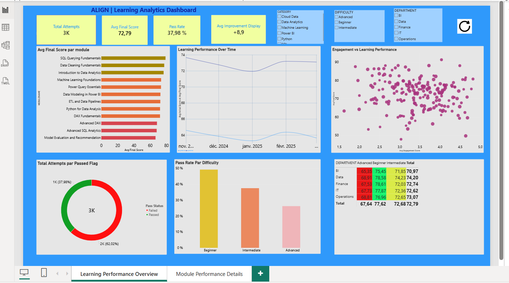
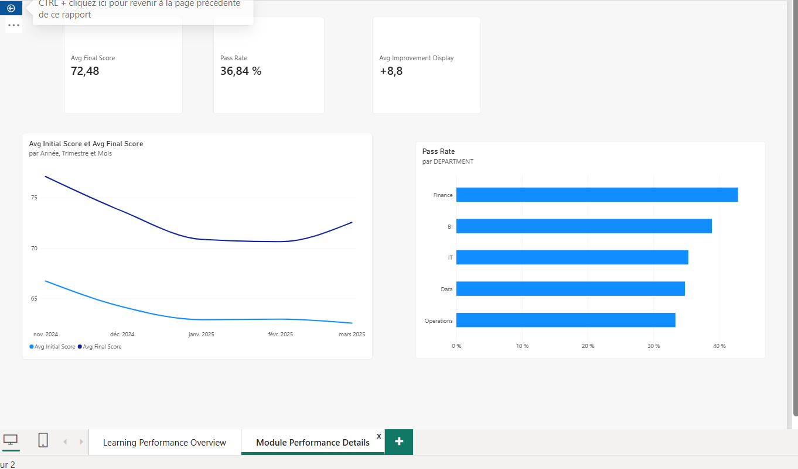

# ALIGN — Power BI Learning Analytics

## 1. Project Overview

This Power BI dashboard is part of the ALIGN Learning Analytics project, designed to analyze learner performance, engagement, and training effectiveness.

The report uses an analytical data model connected to Snowflake, with Azure Data Factory supporting the data pipeline.

**Technologies:** Power BI, DAX, Snowflake, SQL, Azure Data Factory.

## 2. Learning Performance Overview



The main dashboard provides an interactive overview of learner performance across training modules, difficulty levels, and departments.

### Key Performance Indicators

| KPI | Value shown | Description |
|---|---|---|
| Total Attempts | ~3,000 | Number of learning attempts |
| Avg Final Score | 72.79 | Average final assessment score |
| Pass Rate | 37.98% | Percentage of successful attempts |
| Avg Improvement | +8.9 | Average improvement between initial and final scores |

*These values represent the dashboard's displayed dataset and change dynamically with filters.*

### Dashboard Analysis

**Average Final Score by Module**

Compares the average final assessment scores across training modules. Conditional colors help highlight relatively stronger and weaker module results.

**Learning Performance Over Time**

Tracks average initial and final scores over time. The difference between the two lines helps illustrate learning improvement.

**Engagement vs Learning Performance**

A scatter plot explores the relationship between engagement scores and final assessment performance.

**Pass vs Fail Distribution**

The donut chart shows approximately 37.98% passed attempts and 62.02% failed attempts.

**Pass Rate by Difficulty**

Pass rates decrease across difficulty levels, from approximately 49% for Beginner to 38% for Intermediate and 26% for Advanced modules.

**Learning Performance by Department & Difficulty**

A conditional-formatting matrix compares assessment performance across departments and difficulty levels.

## 3. Module Performance Details — Drillthrough



The second report page enables detailed analysis of a selected training module through Power BI drillthrough.

It displays:

- Average Final Score
- Pass Rate
- Average Improvement
- Initial and final assessment score trends
- Pass Rate by Department

This feature allows users to investigate individual modules without losing the selected module context.

## 4. Power BI Data Model — Star Schema


The semantic model follows a star schema with one fact table and three dimensions.

| Table | Role |
|---|---|
| FACT_LEARNINGATTEMPT | Stores assessment results and learning attempt metrics |
| DIM_USER | Learner and department information |
| DIM_MODULE | Training module, category, and difficulty |
| DIM_DATE | Calendar attributes for time-based analysis |

### Relationships

- DIM_USER[USERKEY] → FACT_LEARNINGATTEMPT[USERKEY]
- DIM_MODULE[MODULEKEY] → FACT_LEARNINGATTEMPT[MODULEKEY]
- DIM_DATE[DATEKEY] → FACT_LEARNINGATTEMPT[DATEKEY]

Relationships are configured as one-to-many with single-direction filtering from dimensions to the fact table.

This design supports consistent filtering and simplifies analytical calculations.

## 5. Key DAX Measures

### Total Attempts

```dax
Total Attempts =
COUNTROWS(FACT_LEARNINGATTEMPT)
```

### Average Final Score

```dax
Avg Final Score =
AVERAGE(FACT_LEARNINGATTEMPT[FINALSCORE])
```

### Pass Rate

```dax
Pass Rate =
DIVIDE(
    CALCULATE(
        COUNTROWS(FACT_LEARNINGATTEMPT),
        FACT_LEARNINGATTEMPT[PASSEDFLAG] = 1
    ),
    COUNTROWS(FACT_LEARNINGATTEMPT),
    0
)
```

### Average Improvement

```dax
Avg Improvement =
AVERAGE(FACT_LEARNINGATTEMPT[SCOREIMPROVEMENT])
```

## 6. Interactive Features

- **Category Slicer:** Filters learning modules by training category.
- **Difficulty Slicer:** Filters Beginner, Intermediate, and Advanced modules.
- **Department Slicer:** Analyzes results across departments.
- **Drillthrough:** Opens module-specific performance analysis.
- **Reset Filters Bookmark:** Restores the default report view.
- **Conditional Formatting:** Highlights differences in module and departmental performance.

## 7. Business Value

The dashboard helps stakeholders:

- Identify training modules with lower assessment performance.
- Compare pass rates across difficulty levels.
- Monitor learning progress over time.
- Explore potential relationships between engagement and outcomes.
- Identify differences in performance across departments.

These insights can support decisions about training content, learner support, and learning program improvements.

## 8. Power BI Report File

**File:** `Align_Learning_Analytics.pbix`

The report can be opened using Power BI Desktop. Refreshing the data may require access to the associated Snowflake environment.
